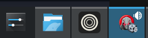
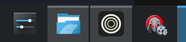

# Editor Window Icon

Tell open Unity projects apart by their icons. The package adds a Unity badge to the project's
Default Icon and applies it to the Editor. Changes apply automatically. Clearing the Default Icon
restores Unity's original icon.

## KDE Plasma in action

| Editor running | Pinned project launcher |
| --- | --- |
|  |  |

Tested on Ubuntu 26.04.1 with Plasma/KWin 6.6.6, XWayland 24.1.10, Unity 6000.6.7f1, and Unity CLI
1.0.0-beta.13. Two running projects appeared as separate taskbar buttons. The test also covered
floating windows, live icon changes, icon reset, and reopening a project from its Plasma launcher
while the previous Editor was shutting down.

## Compatibility

The window protocol column describes **Unity's window**, which can use XWayland inside a Wayland
desktop session.

| Desktop or OS | Unity window protocol | Features | Verification |
| --- | --- | --- | --- |
| Windows | Win32 | Window icons, separate taskbar groups, and pinned relaunch. | Build verified against Unity 6.6. |
| KDE Plasma 6.6.6 on Wayland | XWayland | Live icons on main and floating windows, separate taskbar buttons, and a pinnable project launcher that reopens the same project and Editor version. | Verified on the stack above |
| Other KDE Plasma / KWin setups | X11 or XWayland | Same Linux icon, taskbar grouping, and launcher code paths. | Pending live validation |
| GNOME Shell / Mutter | X11 or XWayland | Window icons and a project launcher. The launcher matches the project's X11 window instance for dock grouping. | Dock grouping and pinning pending live validation. [GNOME Shell matching](https://github.com/GNOME/gnome-shell/blob/46.0/src/shell-window-tracker.c#L183-L201) |
| Cinnamon, Xfce, and other EWMH desktops | X11 or XWayland | Window icons and a project launcher. The shell decides how to display and group tasks. | Pending live validation. [X11 window icon specification](https://specifications.freedesktop.org/wm/latest/ar01s05.html) |
| Native Wayland clients | Wayland | Project launcher only. | Pending live validation |

## Install and use

1. Place this package under `Packages/unity-editor-window-icon` as an embedded package, or install a
   revision of the [fork](https://github.com/Fire-Aalt/unity-editor-window-icon) through
   **Window ▸ Package Manager ▸ + ▸ Install package from git URL**.
2. Set a **Default Icon** in **Project Settings ▸ Player**.
3. To keep a project shortcut, pin its running task in a supported taskbar.

The package declares Unity 2021.3 or newer and runs only in the Editor. Linux window icons use
`libxcb.so.1`. Linux relaunch requires the [Unity CLI](https://docs.unity.com/en-us/unity-cli/use-unity-cli)
and the `flock` utility. The launcher calls `unity open` and waits up to 30 seconds for each launch
lock, including Unity's project lock when the previous Editor is still closing.

## Remove the Linux launcher

The launcher and PNG live under `$XDG_DATA_HOME/applications` and
`$XDG_DATA_HOME/biteme-editor-window-icon`, respectively. The default data directory is
`~/.local/share`. The launcher remains available after the Editor closes.

Before uninstalling, turn off **Tools ▸ Editor Window Icon ▸ Linux Project Launcher** to remove the
project's launcher and restore its original desktop identity while keeping live window icons.
Clearing the Default Icon also removes the launcher. After uninstalling, locate the
`com.biteme.unityeditor.project*.desktop` entry for your project and remove it along with its matching
icon directory.

## License

[CC0 1.0](LICENSE.md)
